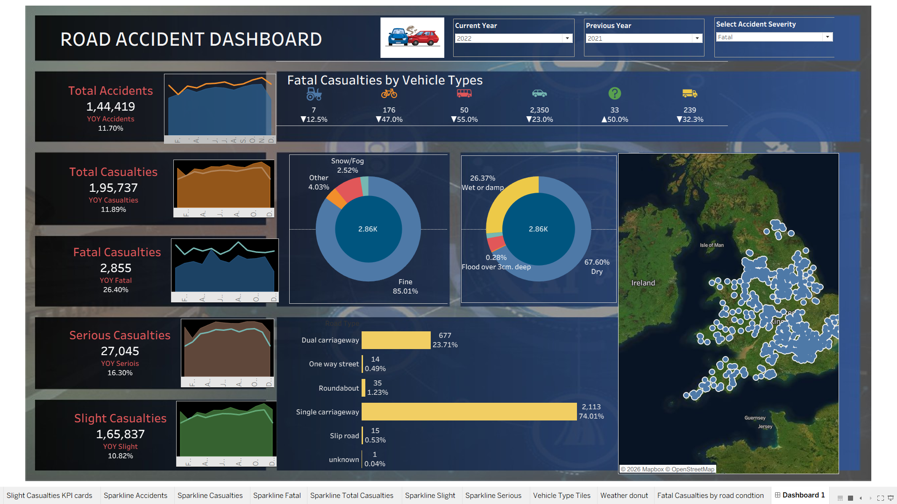

🚗 UK Road Accident Analysis Dashboard | Tableau

An interactive Tableau dashboard analyzing UK road accidents from 2019 to 2022, with year-over-year comparisons, casualty severity analysis, vehicle and road condition insights, and geographic visualization.

  
  
  
  

📊 Dashboard Preview

  

🔗 Live Dashboard: Explore the Interactive Dashboard on Tableau Public

Project Overview

Road accidents are a major public safety concern, resulting in casualties, loss of life, and increased pressure on emergency services.

This project transforms a large road accident dataset into an interactive, single-page Tableau dashboard that helps users understand accident trends, casualty severity, vehicle involvement, road conditions, weather patterns, and accident locations across the United Kingdom.

The dashboard compares a selected current year with a previous year, making it easy to identify changes in accidents and casualties. An interactive severity selector allows users to switch between Fatal, Serious, and Slight casualties across the analytical charts.

The project demonstrates a complete data analytics workflow, from raw data cleaning in Excel Power Query to interactive visualization and dashboard development in Tableau.

🎯 Project Objectives

Analyze road accident and casualty trends from 2019 to 2022.

Compare annual performance using year-over-year (YoY) calculations.

Understand the distribution of casualties by severity.

Identify vehicle types associated with the highest number of casualties.

Explore the relationship between casualties, weather, and road surface conditions.

Identify road types with the highest number of casualties.

Visualize accident locations geographically across the UK.

Build an interactive dashboard to support data-driven decision-making.

🎯 Business Questions

This analysis aims to answer the following questions:

How many accidents and casualties occurred in each year?

How did accidents and casualties change compared with the previous year?

How many casualties were fatal, serious, or slight?

Which vehicle types account for the highest number of fatal casualties?

How are fatal casualties distributed across different weather conditions?

How do road surface conditions relate to fatal casualties?

Which road types account for the largest share of fatal casualties?

Where are accidents geographically concentrated across the UK?

How do the results change when the selected year or casualty severity changes?

🛠️ Tools and Technologies

Tool

Purpose

Microsoft Excel

Data inspection and validation

Power Query

Data cleaning, transformation, and preparation

Tableau Public

Data modeling, calculated fields, parameters, and visualization

GitHub

Version control, documentation, and project showcase

 Project Workflow

The project follows a structured data analytics pipeline:

Raw CSV Dataset
       |
       ▼
Excel Power Query
(Data Cleaning & Transformation)
       |
       ▼
Cleaned Excel Dataset
       |
       ▼
Tableau Data Connection
       |
       ▼
Calculated Fields & Parameters
       |
       ▼
Individual Worksheets
       |
       ▼
Interactive Dashboard
       |
       ▼
Insights & Year-over-Year Analysis

🧹 Data Cleaning in Power Query

The raw CSV dataset was imported into Microsoft Excel using Data → From Text/CSV and transformed in the Power Query Editor.

Data Preparation Steps

1. Data Type Correction

Converted Accident Date to the Date data type using the English (United Kingdom) locale to correctly interpret dates in dd-mm-yyyy format.

Converted Latitude and Longitude to Decimal Number.

Converted casualty and vehicle counts to Whole Number.

Set categorical columns to Text.

2. Text Standardization

Trimmed text columns to remove leading and trailing spaces.

Checked categories for spelling inconsistencies and unwanted variations.

Reviewed the consistency of lighting-condition categories.

3. Missing Value Handling

Column

Cleaning Approach

Road_Surface_Conditions

Replaced 726 blank values with Unknown

Weather_Conditions

Grouped approximately 14,000 blank values into Other

Road_Type

Retained blank values as Null

Latitude and Longitude

Retained records with missing coordinates

Records without geographic coordinates were retained to preserve their contribution to the overall totals. These records cannot be plotted accurately on the map.

4. Duplicate Handling

Repeated Index values were intentionally retained because the dataset contains vehicle-level records. Removing these rows could eliminate valid records from the analysis.

5. Data Validation

Verified the final row count of 660,679 records.

Checked the 2022 subset, which contained 144,419 records.

Reviewed data types, missing values, and category consistency.

Loaded the cleaned data into an Excel worksheet.

Output file: accident_data_cleaned.xlsx

📈 Tableau Development

After cleaning the dataset, the Excel file was connected to Tableau using an extract for analysis and visualization.

1. Data Preparation

Created the following calculated dimensions:

Year: Extracted the year from Accident Date.

Month: Extracted the month from Accident Date.

Both fields were configured as dimensions to support year-based filtering and monthly trend analysis.

2. Vehicle Type Grouping

Vehicle types were grouped into the following categories:

Agricultural

Bus

Car

Truck

Bike

Other

3. Weather Condition Grouping

Weather conditions were consolidated into:

Fine

Rain

Snow/Fog

Other

These groups simplify comparisons and make the dashboard easier to interpret.

4. Interactive Parameters

Three parameters were created to make the dashboard interactive.

Parameter

Data Type

Available Values

Default

Current Year

Integer

2019, 2020, 2021, 2022

2022

Previous Year

Integer

2019, 2020, 2021, 2022

2021

Select Accident Severity

String

Fatal, Serious, Slight

Fatal

The year parameters control annual comparisons, while the severity parameter updates the lower analytical charts.

5. Calculated Fields

Calculated fields were created to compare current-year and previous-year performance.

Current Year Accidents

SUM(
    IF [Year] = [Current Year]
    THEN 1
    ELSE 0
    END
)

Previous Year Accident

SUM(
    IF [Year] = [Previous Year]
    THEN 1
    ELSE 0
    END
)

Year-over-Year Accidents

(
    ZN([Current Year Accidents])
    - ZN([Previous Year Accident])
)
/
ZN([Previous Year Accident])

Current Year Fatal Casualties

SUM(
    IF [Year] = [Current Year]
    AND [Accident Severity] = "Fatal"
    THEN [Number_of_Casualties]
    END
)

Current Year Selected Severity

SUM(
    IF [Year] = [Current Year]
    AND [Accident Severity] = [Select Accident Severity]
    THEN [Number_of_Casualties]
    END
)

The same calculation pattern was applied to total casualties, serious casualties, slight casualties, and the selected severity.

Year-over-year calculations were also created for the KPI metrics. Custom number formatting was used to display directional indicators, such as ▲ for increases and ▼ for decreases.

Calculation note: A zero previous-year value requires special handling to avoid division by zero. The year-over-year calculation should return Null or a suitable fallback when the previous-year denominator is zero.

6. Dashboard Worksheets

The following worksheets were developed:

Worksheet

Visualization

Total Accidents

KPI card with monthly trend

Total Casualties

KPI card with monthly trend

Fatal Casualties

KPI card with monthly trend

Serious Casualties

KPI card with monthly trend

Slight Casualties

KPI card with monthly trend

Casualties by Vehicle Type

Shape-based icon tiles

Casualties by Weather

Donut chart

Casualties by Road Surface

Donut chart

Casualties by Road Type

Horizontal bar chart with values and percentages

Accident Locations

Geographic map of the UK

The KPI cards use monthly sparklines to compare the current and previous years, with a blue area for the current year and an orange line for the previous year.

✨ Dashboard Features

📅 Dynamic Year Comparison

Select a current year and a previous year to compare accident and casualty metrics.

🎚️ Casualty Severity Selector

Switch between Fatal, Serious, and Slight casualties to explore different accident outcomes across the lower charts.

📊 Five KPI Cards

Monitor total accidents, total casualties, fatal casualties, serious casualties, and slight casualties.

📈 Monthly Trend Analysis

Compare monthly patterns across the selected years using sparklines.

🚘 Vehicle Type Analysis

Identify which vehicle categories account for the highest number of casualties.

🌦️ Weather and Road Surface Analysis

Explore the distribution of casualties across weather and road surface conditions.

🛣️ Road Type Comparison

Compare casualty counts and percentages across different road types.

🗺️ Geographic Visualization

Explore accident locations across the UK using a dark-themed map.

🎨 Professional Dashboard Design

A dark blue background, orange accents, transparent worksheets, floating layouts, and a structured title bar create a consistent visual experience.

🔍 Key Insights

The following insights are based on the dashboard's reported results for 2022 compared with 2021, with Fatal selected in the severity parameter.

1. Year-over-Year KPI Comparison

Metric

2022 Value

YoY Change

Total Accidents

144,419

↓ 11.70%

Total Casualties

195,737

↓ 11.89%

Fatal Casualties

2,855

↓ 26.40%

Serious Casualties

27,045

↓ 16.30%

Slight Casualties

165,837

↓ 10.82%

Key takeaway: The reported number of fatal casualties declined more sharply than the other casualty categories, indicating a substantial improvement in this measure during 2022.

2. Casualties by Vehicle Type

Cars accounted for 2,350 fatal casualties, the largest number among the vehicle groups.

Trucks accounted for 239 fatal casualties.

Bikes accounted for 176 fatal casualties.

The Other vehicle group recorded an increase of 50%, reaching 33 fatal casualties.

Key takeaway: Cars represented the largest share of fatal casualties in the selected year. The percentage increase for the Other group should be interpreted in the context of its small absolute count.

3. Casualties by Weather Condition

Fine weather accounted for approximately 85.01% of fatal casualties.

Key takeaway: Most fatal casualties occurred in fine weather. This does not establish that weather has no effect on accident severity; exposure, traffic volume, and driver behaviour would need to be considered for a deeper analysis.

4. Casualties by Road Surface

Dry road surfaces accounted for approximately 67.60% of fatal casualties.

Wet roads accounted for approximately 27%.

Key takeaway: Dry roads represented the largest share of fatal casualties in the dataset. These percentages describe the observed distribution, not the risk per journey or per kilometre travelled.

5. Casualties by Road Type

Single carriageways accounted for 2,113 fatal casualties, approximately 74.01%.

Dual carriageways accounted for approximately 23.71%.

Key takeaway: Single carriageways accounted for the largest share of fatal casualties. Traffic exposure, road length, and vehicle volume would be needed to determine whether they have a higher underlying risk.

💡 Skills Demonstrated

Data cleaning and transformation using Excel Power Query.

Data type conversion and missing-value handling.

Data validation and quality checks.

Tableau calculated fields and conditional aggregation.

Parameter-driven dashboard development.

Year-over-year KPI analysis.

Time-series and monthly trend visualization.

Geographic mapping and categorical analysis.

Dashboard layout, formatting, and data storytelling.

GitHub documentation and project presentation.

👨‍💻 Author

Avirag

Aspiring Data Analyst | Tableau | SQL | Excel | Power BI | Python

GitHub: Visit My GitHub Profile

Tableau Public: Explore My Tableau Work

LinkedIn: Connect with Me

⭐ If you find this project useful, feel free to star the repository!

This project is intended for educational and analytical purposes. Findings describe the available dataset and should not be interpreted as causal conclusions about road safety.
